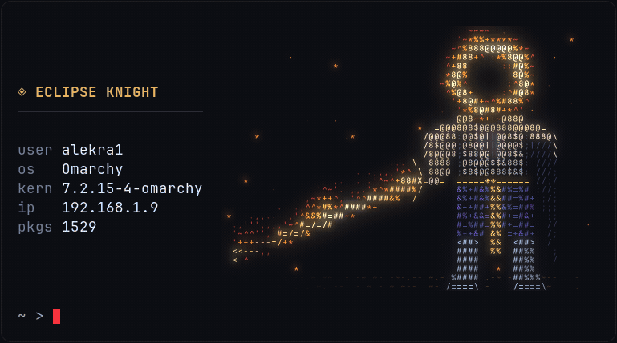
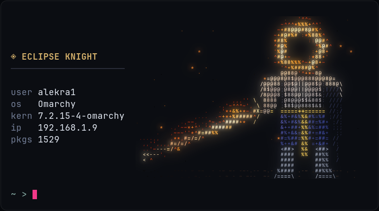
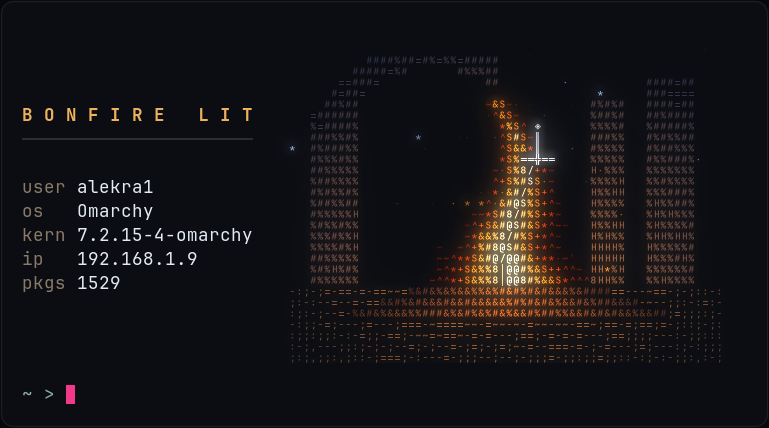
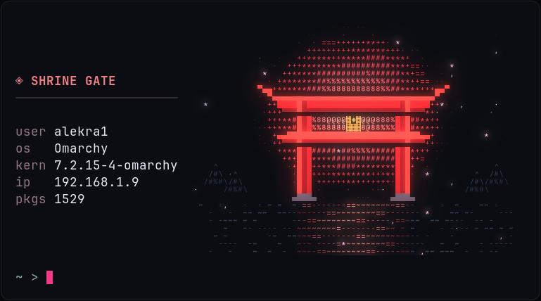
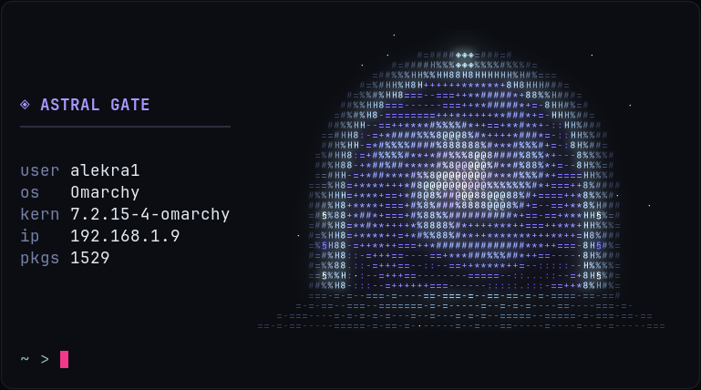
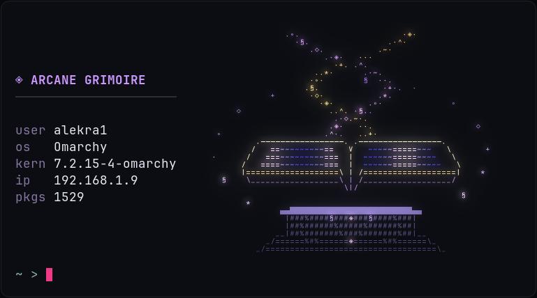
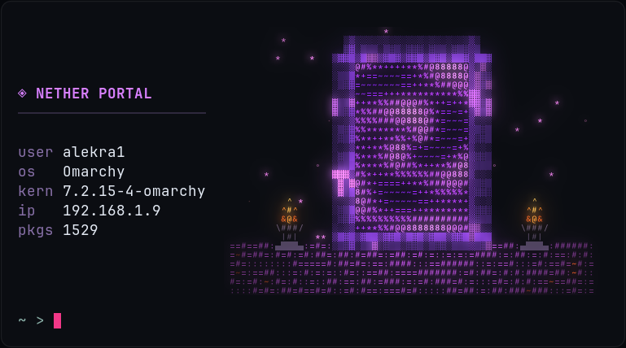

# greeting

A lightweight Rust terminal greeting banner that renders **live, animated dark-fantasy ASCII scenes with real HDR optical bloom** alongside a compact native system HUD — without touching your terminal config or slowing down shell startup.

<p align="center">
  
</p>

It automatically selects the best rendering backend for your terminal:

| Terminal | Backend | Visual Quality |
|---|---|---|
| **Ghostty**, **Kitty**, **WezTerm** | Kitty Graphics Protocol (`f=32`, zlib) | 32-bit RGBA alpha-blended optical bloom over transparent/blurred backgrounds |
| **foot**, **mlterm**, **Contour** | Native transparent Sixel (`P2=1`) | 1:1 native-pixel tiny-font glyphs + adaptive 240-color palette + Bayer-feathered glow |
| **tmux**, **screen**, SSH, narrow panes, `--text` | Pure 24-bit TrueColor ANSI text | Universal zero-dependency fallback |

The banner runs in a detached background animator so your shell prompt appears immediately below it. Scenes keep animating (~16–20 FPS) and randomly switch every 5 seconds **while you type**, recover cleanly when you resize the window, and stop automatically as soon as you execute a command.

The classic collectible pet system is also preserved under `greeting pet`, `greeting roll`, `greeting collection`, `greeting set`, `greeting unset`, and `greeting catalog`.

---

## Scenes

<table>
  <tr>
    <td align="center" width="50%">
      <br />
      <strong>1. Eclipse Knight</strong> (<code>eclipse</code>, <code>knight</code>)
    </td>
    <td align="center" width="50%">
      <br />
      <strong>2. Ruined Bonfire</strong> (<code>bonfire</code>, <code>fire</code>)
    </td>
  </tr>
  <tr>
    <td align="center" width="50%">
      <br />
      <strong>3. Moonlit Torii</strong> (<code>torii</code>, <code>shrine</code>, <code>moon</code>)
    </td>
    <td align="center" width="50%">
      <br />
      <strong>4. Astral Gate</strong> (<code>portal</code>, <code>astral</code>, <code>gate</code>)
    </td>
  </tr>
  <tr>
    <td align="center" width="50%">
      <br />
      <strong>5. Arcane Grimoire</strong> (<code>grimoire</code>, <code>book</code>, <code>tome</code>)
    </td>
    <td align="center" width="50%">
      <br />
      <strong>6. Nether Portal</strong> (<code>nether</code>, <code>mc</code>, <code>minecraft</code>)
    </td>
  </tr>
</table>

---

## Install

### Prerequisites
- Rust toolchain (`cargo`)
- System `zlib` (`libz.so` — installed by default on virtually all Linux distros)

### Build & install
```bash
git clone git@github.com:Alekra1/greeting-buddy.git greeting
cd greeting
cargo install --path .
```

Make sure `~/.cargo/bin` is on your `PATH`:
```bash
export PATH="$HOME/.cargo/bin:$PATH"
```

---

## Shell Integration (`~/.bashrc`)

To run `greeting` automatically when opening a terminal and ensure the background animator stops cleanly even on shell builtins (`cd`, `echo`, etc.), add this block once to `~/.bashrc`:

```bash
export PATH="$HOME/.cargo/bin:$PATH"
_GREETING_PID_FILE="/tmp/greeting-tty-$(tty 2>/dev/null | tr '/' '-').pid"
_greeting_prompt_hook() {
  [[ -f "$_GREETING_PID_FILE" ]] || return
  local pid armed
  read -r pid armed < "$_GREETING_PID_FILE" 2>/dev/null || return
  if [[ "$armed" == "0" ]]; then
    printf '%s 1\n' "$pid" > "$_GREETING_PID_FILE" 2>/dev/null
  else
    kill -TERM "$pid" 2>/dev/null
    rm -f "$_GREETING_PID_FILE" 2>/dev/null
  fi
}
PROMPT_COMMAND="${PROMPT_COMMAND:+$PROMPT_COMMAND;}_greeting_prompt_hook"
greeting
```

### How lifecycle works
1. `greeting` paints frame 1 immediately, parks the cursor below the 15-row banner, writes `<daemon_pid> 0` to `/tmp/greeting-tty-<tty>.pid`, and exits so bash displays your prompt right away.
2. When bash renders the initial prompt, `_greeting_prompt_hook` arms the PID file (`0` → `1`) without killing the daemon — so animation continues while you sit at the prompt or type.
3. As soon as you press Enter:
   - External commands change the TTY foreground process group (`tcgetpgrp`), causing the daemon to exit immediately on its own.
   - Shell builtins keep the same process group, so on the next prompt `_greeting_prompt_hook` sees `armed == 1` and sends `SIGTERM` to stop the daemon cleanly.

---

## CLI Usage

```bash
greeting                       # Live background top-banner (random scene every 5s)
greeting -s torii              # Start on a specific scene (name or 1-6)
greeting -i 10                 # Switch scenes every 10 seconds (0 disables auto-switch)
greeting --static              # Render a single frame inline and exit immediately
greeting --fg                  # Interactive foreground viewer
greeting --text                # Force pure 24-bit TrueColor text (skip Kitty/Sixel graphics)
```

### Interactive foreground controls (`greeting --fg`)
- `1`–`6`: Jump directly to a scene
- `Space` / `n` / `r` / `→`: Switch to another random scene
- `←`: Previous scene
- `p` / `l`: Lock / unlock automatic scene rotation
- `q` / `Enter` / `Esc` / `Ctrl-C`: Exit

### Classic collectible pet subcommands
```bash
greeting pet                   # Show the classic starry pet greeting card
greeting roll                  # Roll a new pet drop (5-minute cooldown)
greeting collection            # List all collected pet drops
greeting set <number>          # Pin a collected pet as default
greeting unset                 # Return to random drops
greeting catalog               # Show all 18 species and counts owned
```

Pet collection state is stored at `~/.config/terminal-greeting/state.json`.

---

## Architecture

| Path | Responsibility |
|---|---|
| `src/main.rs` | CLI parsing (`clap`), subcommand dispatch, hidden `--daemon` / `--dump-rgba` / `--dump-time` flags |
| `src/scenes.rs` | Pure-text `70×17` fallback scenes, hybrid native HUD (`23` cols) + HD layout math, background daemon, resize debouncing, foreground viewer |
| `src/scenes_hd.rs` | All 6 high-detail `66×30` tiny-font ASCII scenes and per-scene HUD accent styles |
| `src/gfx.rs` | `BloomRenderer` (glyph blitting, 2-scale half-res separable Gaussian bloom, HDR soft-knee tone mapping), Kitty Graphics Protocol (`zlib` + base64 chunker), native transparent Sixel encoder (adaptive 12-bit 240-color palette + Bayer alpha dithering), `/proc` + env terminal protocol auto-detection |
| `src/font_atlas.rs` | Pre-baked `7×11` antialiased `JetBrainsMono` alpha bitmaps (111 glyphs, including geometric stipple `▓`/`▒`/`░` and crisp `=`) |
| `src/sysinfo.rs` | Fast local OS, kernel, IP, and package count gathering |
| `src/display.rs`, `src/pets.rs`, `src/collection.rs`, `src/state.rs` | Classic collectible pet system |
| `assets/` | Headlessly rendered showcase PNGs and animated hero GIF for README |

---

## Further Reading

- **[PITFALLS.md](PITFALLS.md)** — Terminal protocol, PTY, Sixel/Kitty graphics, resize, and font-atlas gotchas discovered while building this.
- **[AGENTS.md](AGENTS.md)** — Architecture invariants, style rules, and headless testing workflow for contributors and coding agents.
